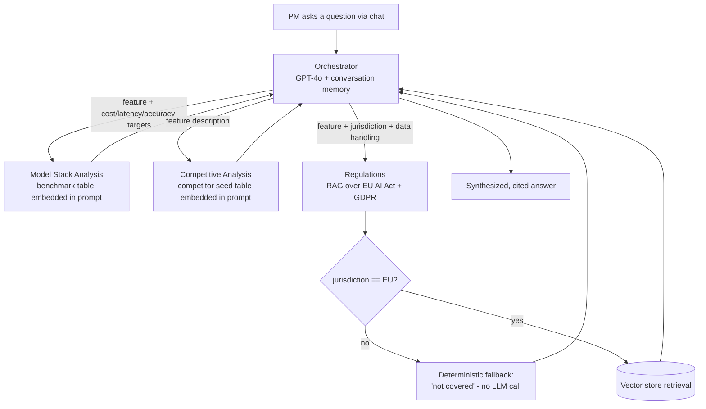

# ShipWise AI (n8n prototype)

Picking an AI model for a new feature takes a product manager days of digging through pricing pages, vendor claims and legal questions. ShipWise AI is a multi-agent system that does that digging: you describe the feature you want to add, and it researches the cost, performance, competitors and regulation behind the choice of model (GPT-4, Claude or open source).

This is the first version, a prototype I built in n8n to test the idea end to end. It covers customer-support features for B2B SaaS. A second version, rebuilt on Azure AI Foundry with live tools and a real front end, is here: [ShipWiseAI-Azure-Foundry](https://github.com/singhpriyankao/ShipWiseAI-Azure-Foundry).

I built the workflows myself in n8n, using Claude to talk through design trade-offs along the way.

## How it works

One Orchestrator takes the PM's question and routes it to three sub-agents, each built and tested on its own.

The Orchestrator calls the sub-agents with n8n's Execute Sub-workflow pattern. I started with the Call n8n Workflow Tool node, but it wasn't reliable in this build, so I rebuilt the routing around a more stable connection.

## Three decisions worth explaining

**Retrieval only where the data is big.** Model Stack Analysis and Competitive Analysis keep their small reference tables inside the prompt. Only Regulations uses real vector retrieval, because the EU AI Act and GDPR are far too large to paste in. Building RAG for a screen's worth of benchmark numbers would have solved a problem I didn't have.

**The model is chosen per component.** All three sub-agents use GPT-4o, but for different reasons, each tied to how costly a wrong answer is in that spot. Regulations is the highest-priority tier for accuracy, because a wrong answer there is a legal and reputational risk, not just a number that's off.

**A guardrail in front of the highest-risk answer.** When I asked Regulations about a jurisdiction outside its documents, such as California's CCPA, it didn't say "I don't know". Vector search always returns the closest chunk, and the model filled the gap from general knowledge even though it had been told not to. A better prompt wasn't the fix. I put a gate in front of the model that returns a fixed "not covered" answer for any non-EU jurisdiction, and the model never sees the question.

## How I tested it

I wrote 33 test criteria across five areas (Orchestrator, Competitive Analysis, Regulations, Model Stack Analysis and the Feedback Collector), then turned them into 16 automated regression cases, four for each workflow I had built.

Each Orchestrator test has two scores. An LLM judge grades the final answer against an explicit rule. A second, plain-code check confirms the right tool was called (`correct_routing`). I added the second one after the judge alone missed a real bug where the wrong tool answered. The final text still sounded fine, so the judge couldn't tell.

All four workflows have a working offline pipeline from dataset to judge to scoring. Getting there meant fixing real problems: malformed JSON bodies, Code nodes that failed silently, and sessions leaking into each other.

## What's in the repo

| Folder | What it is |
|---|---|
| `n8n-workflows/` | The exported workflows: the Orchestrator with all sub-agents, and each sub-agent on its own. They import straight into n8n. |
| `Evals/` | The test criteria and eval schema behind the automated tests |
| `Design/` | UI mockups for a front end |

## What this prototype doesn't prove

1. **The data is static.** The benchmark and competitor tables are hand-written snapshots. There's no live pricing or search.
2. **There's no production monitoring.** This is an offline regression suite. It reruns a fixed set of cases on every change, so it can stay green while real conversations fail in ways I never thought to test. Nothing samples or grades real usage.
3. **It doesn't learn.** Past recommendations and how they turned out never feed back into later ones.

Closing those three gaps is what the Azure AI Foundry version is for.

## Stack

n8n (workflows, AI Agent nodes, vector store) and OpenAI GPT-4o.
